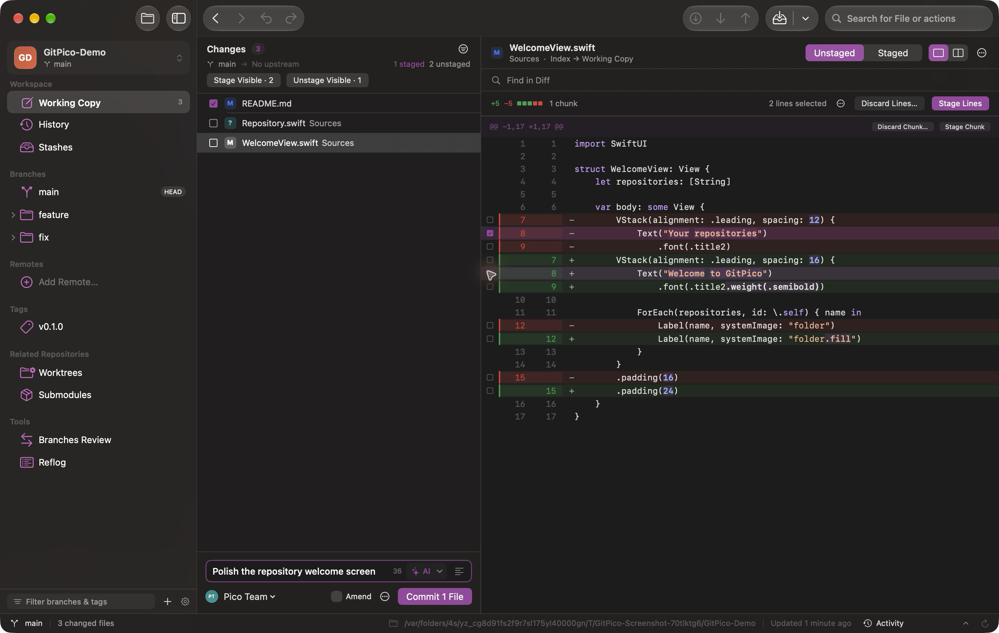

# GitPico

A native Git client for macOS. Review changes, build focused commits, explore history, and manage your repositories in a SwiftUI interface.

**macOS 26 or later** · [Download](https://github.com/WillSuo-Github/GitPico/releases/latest) · [Report an issue](https://github.com/WillSuo-Github/GitPico/issues)



## Features

- **Review and commit changes.** Read unified or side-by-side diffs with syntax highlighting, inline change highlights, and search. Stage entire files, individual hunks, or selected lines. Amend commits, add sign-offs, and reuse commit templates and author identities.
- **Explore repository history.** Browse the commit graph, filter by author, date, path, or message, and compare branches, tags, and commits. Follow file renames, inspect blame, restore historical files, and export files or revision trees.
- **Manage branches and integrations.** Create and organize branches and tags, review ahead/behind counts, and merge, rebase, cherry-pick, or revert changes. Interactive rebase helps you reorder and edit commits; the conflict editor provides source previews and an editable result.
- **Keep work organized.** Group and favorite repositories, switch with Quick Open, and work across native window tabs. Manage stashes, worktrees, and submodules, with Git LFS and classic Git Flow tools available when needed.
- **Connect to your remotes.** Clone, fetch, pull, and push with visible progress and network activity. Sign in to GitHub or GitLab, use HTTPS tokens stored in Keychain, or keep using your existing Git credentials and SSH agent. Open pull requests and merge requests on the hosting website.
- **Recover supported changes.** Undo and redo supported history operations, restore GitPico's local-change backups, or use Reflog to find earlier commits. Conflict drafts are saved so you can resume your work.
- **Draft commit messages with AI.** Use an installed Codex CLI, Claude Code, Antigravity, or GitHub Copilot CLI to generate an editable message from your changes. Choose the message language and customize the writing instructions.

GitPico supports light and dark appearance, keyboard shortcuts, and a multilingual interface that follows your macOS app-language setting.

## Install

1. Download the `GitPico-<build>.zip` archive from [GitHub Releases](https://github.com/WillSuo-Github/GitPico/releases/latest).
2. Unzip it and move **GitPico.app** to **Applications**.
3. Open GitPico and choose a local repository, clone a remote, or create a new one.

GitPico uses the system Git at `/usr/bin/git`. If macOS asks to install Command Line Tools, complete that installation first. Git LFS features also require a local `git-lfs` installation.

Updates are available through the app; downloading GitPico and its updates does not require a GitHub account.

GitPico is under active development. For bugs or feature requests, [open an issue](https://github.com/WillSuo-Github/GitPico/issues) and include your macOS version, GitPico build number from Settings, and steps to reproduce the problem.

## Get started

Open a repository and select **Working Copy** to review changed files. Stage the files or lines you want to include, write a commit message, and commit. Use **History** to browse earlier work, **Stashes** to set changes aside, and **Branches Review** to compare branches.

| Action | Shortcut |
| --- | --- |
| Open a repository | `⌘O` |
| Quick Open | `⌘⇧O` |
| Clone a repository | `⌘⌥O` |
| Quick Actions | `⌘⇧A` |
| Working Copy / History | `⌘1` / `⌘2` |
| Commit staged changes | `⌘Return` |
| New tab / Close tab | `⌘T` / `⌘W` |

### AI commit messages

Install and sign in to a supported AI CLI, then choose it in **Settings → AI Commits**. In the commit editor, choose whether to use staged changes or staged and unstaged changes, then click **AI**. Review and edit the generated message before committing.

The chosen diff is sent to the CLI's configured AI service and may use your subscription allowance or API credits. Including unstaged changes also includes untracked files. Generation fills the commit editor; it never creates a commit automatically.

## Build from source

Use Xcode with the macOS 26 SDK or later.

1. Clone this repository and open **GitPico.xcodeproj**.
2. Select the shared **GitPico** scheme and **My Mac**.
3. Press `⌘R` to build and run, or `⌘U` to run the tests.

Local builds use ad-hoc signing and do not require an Apple Developer team. Xcode resolves the package dependencies automatically; XcodeGen is only needed when regenerating project settings.

For command-line builds and background verification:

```sh
./script/build_and_run.sh --build-only  # Build the app at dist/GitPico.app
./script/build_and_run.sh --verify      # Build and verify without activating app windows
swift test                             # Run the SwiftPM test suite
```

The Xcode scheme's tests also run without opening app windows. Git integration tests use disposable local repositories.

## Project documentation

- [Release packaging and updates](docs/DISTRIBUTION.md)
- [Localization](docs/LOCALIZATION.md)
- [Development roadmap](docs/ROADMAP.md)
- [Development agreements](AGENTS.md)
